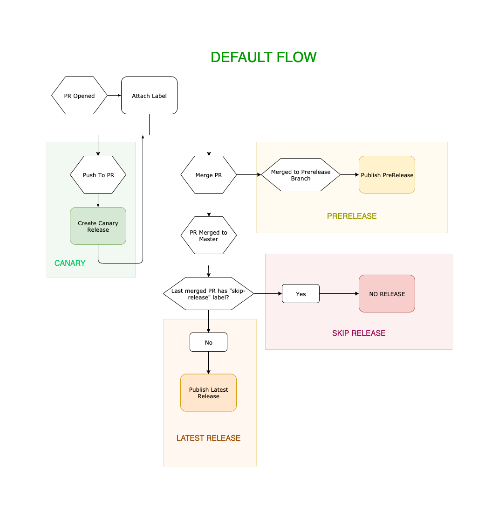
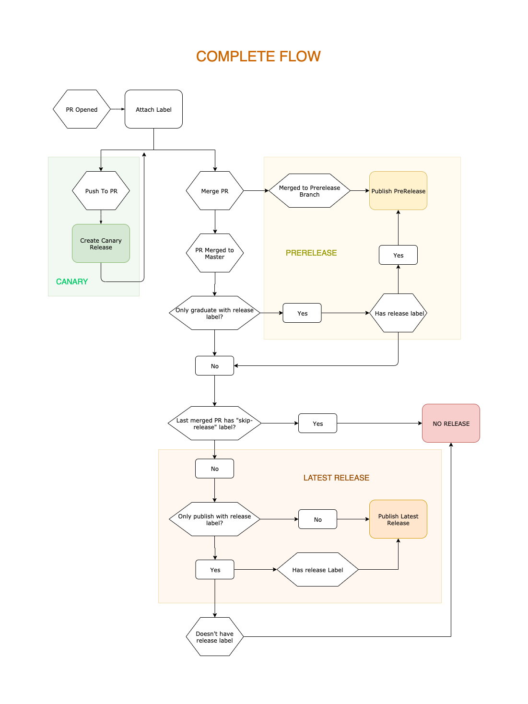
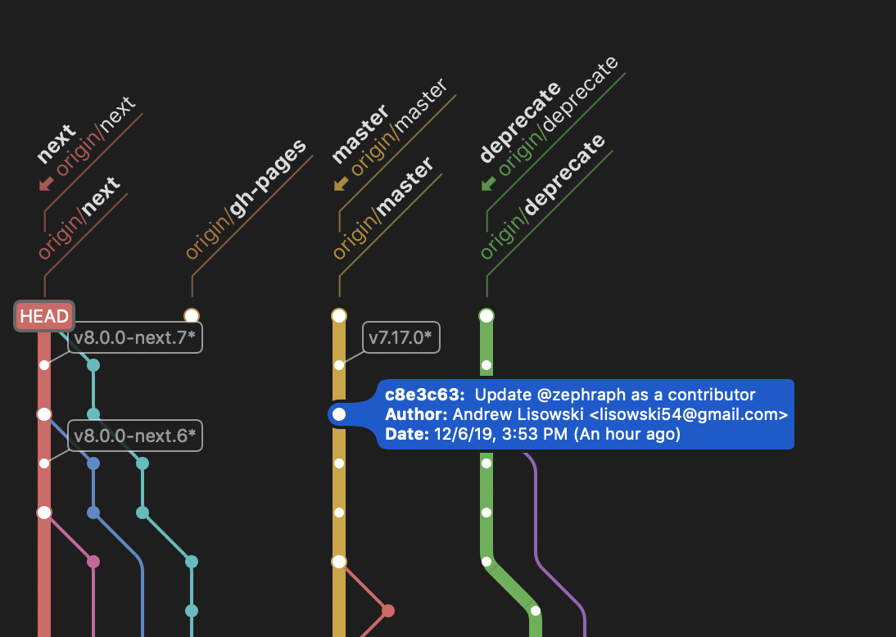

Context aware publishing.

1. call from base branch -> latest version released (LATEST)
2. call from prerelease branch -> prerelease version released (NEXT)
3. call from PR in CI -> canary version released (CANARY)
4. call locally when not on base/prerelease branch -> canary version released (CANARY)

## Options

| Flag                                 | Type    | Description                                                                                                                                                                                                                                              |
| ------------------------------------ | ------- | -------------------------------------------------------------------------------------------------------------------------------------------------------------------------------------------------------------------------------------------------------- |
| `--name`                             | String  | Git name to commit with. Defaults to package definition for the platform                                                                                                                                                                                 |
| `--email`                            | String  | Git email to commit with. Defaults to package definition for the platform                                                                                                                                                                                |
| `--only-publish-with-release-label`  | Boolean | Only bump version if 'release' label is on pull request                                                                                                                                                                                                  |
| `--base-branch`                      | String  | Branch to treat as the base branch                                                                                                                                                                                                                       |
| `--dry-run`, `-d`                    | Boolean | Report what command will do but do not actually do anything                                                                                                                                                                                              |
| `--no-version-prefix`                | Boolean | Use the version as the tag without the 'v' prefix. WARNING: some plugins might need extra config to use this option (ex: npm)                                                                                                                            |
| `--prerelease`                       | Boolean | Publish a prerelease on GitHub.                                                                                                                                                                                                                          |
| `--title`                            | String  | Override the title used in the addition to the CHANGELOG.md.                                                                                                                                                                                             |
| `--message`, `-m`                    | String  | Message to commit the changelog with. Defaults to 'Update CHANGELOG.md [skip ci]'                                                                                                                                                                        |
| `--quiet`, `-q`                      | Boolean | Print **only** the result of the command                                                                                                                                                                                                                 |
| `--no-changelog`                     | Boolean | Skip creating the changelog                                                                                                                                                                                                                              |
| `--use-version`                      | String  | Version number to publish as. Defaults to reading from the package definition for the platform. Currently only supported for the **npm plugin**.                                                                                                         |
| `--only-graduate-with-release-label` | Boolean | Make auto publish prerelease versions when merging to baseBranch. Only PRs merged with "release" label will generate a "latest" release. Only use this flag if you do not want to maintain a prerelease branch, and instead only want to use baseBranch. |

## Examples

```bash
auto shipit
```

## Configurable Options

You can configure some of the options for the `shipit` command in the `.autorc`.

- `prerelease`
- `message`
- `no-changelog`
- `only-graduate-with-release-label`

> [!warning]
> `onlyGraduateWithReleaseLabel` in `.autorc` has no effect, because the CLI's default for `--only-graduate-with-release-label` (`false`) overrides it. Pass the flag instead: `auto shipit --only-graduate-with-release-label`.

**Example `.autorc`:**

```json
{
  "shipit": {
    "prerelease": true,
    "message": "string",
    "noChangelog": true,
    "onlyGraduateWithReleaseLabel": true
  }
}
```

## Release Pipeline

Below is the basics steps auto takes when releasing your code through the `shipit` command.



You can customize how this pipeline operates with various flags.
The following shows how those flags can effect the workflow.



## Managing Old Major Versions

This command also has the ability to help you manage old major versions too!
This feature is off by default, to enable set `versionBranches` to `true` in your [.autorc](../configuration/autorc#versionbranches).

With this feature enabled `auto shipit` will:

- Create a version branch when a `major` happens (prefixed with `version-`)
- When ran from a `versionBranch` make a release to that version

Now that you have a branch for an old major release, it is super easy to release patches to it!
People can make PRs to the the `version-` branch and once merged create a new release of that version.

### Customize Branch Prefix

You can customize what the branch names will be by setting `versionBranches` to a string.

```json
{
  "versionBranches": "Major-"
}
```

## Prereleases

If you are interested in pre-releases (ex: `alpha`, `beta`, `next`) `auto` has the ability to publish pre-releases in various ways.

Read more about preparing you project for pre-releases [here](./next#setting-up-protected-branches).

### Strategies

#### "next" Branch (default)

The suggested way to create pre-releases is by managing 2 branches for your repo: `baseBranch` and `next`.
`baseBranch` contains the `latest` stable version of the code, and `next` contains future updates.

You can change what branches `auto` treats as pre-release branches in your [`.autorc`](../configuration/autorc#prerelease-branches).



To update the `latest` stable version simply merge your pre-release branch into your `baseBranch`.

#### Without "next" Branch (`--only-graduate-with-release-label`)

If you use the `--only-graduate-with-release-label` flag, you do not have to manage 2 branches.
Instead you only have a `baseBranch` and do all work and pull requests there.
`auto` will only publish pre-releases when PRs are merged.
To update the `latest` stable version add the `released` label to the PR.

While this setup may be simpler, it restricts you from updating latest while development is happening for the pre-release.
With 2 branches you can easily merge update to the latest release, with 1 this is not possible.

#### Multiple "next" Branches

Sometimes you might want to have more rigorous release lines.
This can help test out bugs on a smaller set of users.

One setup you could use to accomplish this is by creating 3 `prereleaseBranches`

```json
{
  "prereleaseBranches": ["alpha", "beta", "rc"]
}
```

You could then set you default to `alpha` and `auto` would publish updates merged to that branch under the `alpha` release tag.
When you are ready for the update to get used by more users just merge `alpha` into `beta`.
This will publish a `beta` release to the matching release tag.
Repeat this same process when graduating to `rc` or `latest`.

#### Feature Pre-releases

Sometimes you are working on a large feature that requires a lot of work.
Instead of making a giant PR with a bunch of updates, you can create a `prereleaseBranch` to track the work.

```json
{
  "prereleaseBranches": ["next", "my-cool-feature"]
}
```

Now instead of just getting a canary version when merging into the `my-cool-feature` branch, a prerelease version is published under the `my-cool-feature` release tag!
This enables other to consume just this line of work and enables your work to be more flexible.
